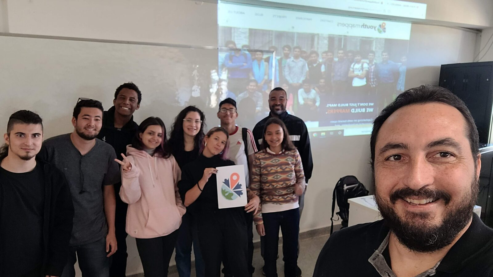



O Mapeamento na cidade de Angra dos Reis/RJ tem como objetivo incluir edifícios, estradas rurais, pontos de interesses (comércio em geral, escolas, postos de saúde, praças) e áreas verdes nos locais de mata, melhorando assim os dados do OpenStreetMap. 

## Fotos

Clique em uma foto para ampliar e use as setas para navegar.

::: {.galeria}
{group="mapathon" fig-alt="Abertura da atividade"}

{group="mapathon" fig-alt="Equipe"}

{group="mapathon" fig-alt="Equipe"}

:::
